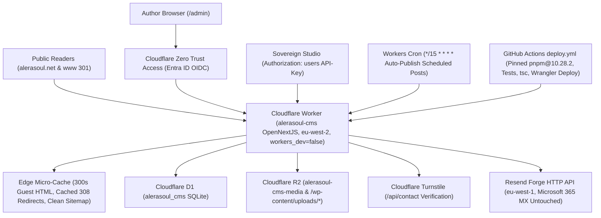

# alerasoul-cms

Official **Payload CMS v3** edge publishing platform for [`alerasoul.net`](https://alerasoul.net) running on **Cloudflare Workers**, **Cloudflare D1**, **Cloudflare R2**, **Resend Forge**, and **Cloudflare Turnstile**.

## Visual Topology



## Architecture & Capabilities

- **Collections**:
  - `Users`: Role-scoped accounts (`admin`, `publisher`) with Payload v3 `API-Key` authentication enabled for automated publishing clients.
  - `Posts`: Full editorial schema (`title`, `/%postname%/` `slug`, `status: draft | scheduled | published`, UTC `publishedAt`, `excerpt`, `content` Lexical AST, `legacyHtml`, `categories`, `tags`, `featuredImage`, `githubRepoUrl`, `seo`, `readingTimeMinutes`) with server-side Zero-Leak & Silo prefix guards.
  - `Pages`: Published static editorial pages (`/about/`, `/architecture/`, `/privacy/`).
  - `Categories`: Canonical taxonomy (`enterprise-architecture`, `personal`, `psychology`).
  - `Media`: R2-backed upload collection (`alerasoul-cms-media`).
  - `ContactSubmissions`: Turnstile-verified public contact inquiries (`POST /api/contact`).
- **Dark Azure Editorial UI & RSS**:
  - Responsive Dark (`#0a1128`) and Light (`#f8fafc`) Azure theme tokens (`--sov-bg`, `--sov-surface`, `--sov-text`, `--sov-cyan`, `--sov-sky`) using `Inter` and `JetBrains Mono`.
  - Automatic sticky Table of Contents, code block copy buttons, diagram lightbox zoom, `TechArticle` JSON-LD schema, LinkedIn sharing bar, GitHub Repository CTA cards, category archives (`/category/<slug>/`), and WordPress-compatible RSS 2.0 XML (`/feed/`).
- **Edge Middleware, Caching & Scheduled Auto-Publisher**:
  - Canonical `www` to apex `301` redirect, clean non-trailing-slash XML sitemap (avoiding `308` hops), edge-cached `308` Silo sequence/legacy redirects, and a `300s` guest HTML edge micro-cache.
  - Sensitive probe path blocking (`403`) and zero-404 `/wp-content/uploads/*` asset serving directly from Cloudflare R2.
  - Cloudflare Workers Cron (`*/15 * * * *`) promoting `scheduled` posts whose `publishedAt <= now()` to `published`.
- **Cloudflare Zero Trust Access, Turnstile & Transactional Email**:
  - `wrangler.jsonc` enforces `"workers_dev": false` and `"preview_urls": false` (pinned `aws:eu-west-2`) so unauthenticated `*.workers.dev` endpoints are never exposed.
  - Interactive `/admin/*` management routes are protected behind **Cloudflare Zero Trust Access** (Entra ID OIDC), while public articles, `/feed/`, and scoped `Authorization: users API-Key` REST publishing routes remain directly reachable.
  - Contact submissions (`POST /api/contact`) enforce server-side **Cloudflare Turnstile** verification via `TURNSTILE_SECRET_KEY` and dispatch notifications via **Resend** (`RESEND_API_KEY` in `eu-west-1`), preserving Microsoft 365 root MX/SPF/Autodiscover DNS records untouched.
- **Portability Escape Hatch & CI/CD**:
  - Ships a 12-line `Dockerfile` (`# PORTABILITY_ESCAPE_HATCH_ONLY — Live production runs on Cloudflare Workers/PaaS`) for portable Node.js container execution.
  - Automated CI verification (pinned `pnpm@10.28.2`, `tsc`, integration tests) and OpenNext/Wrangler deployment run via [`.github/workflows/deploy.yml`](.github/workflows/deploy.yml).

## Documentation

- Publishing REST Contract: [`docs/PUBLISHING-API-CONTRACT.md`](docs/PUBLISHING-API-CONTRACT.md)
- Machine-Readable Schema: [`docs/publishing-api-contract.schema.json`](docs/publishing-api-contract.schema.json)

## Verification, Build & Deployment

```bash
pnpm install
pnpm run test:int
pnpm exec tsc --noEmit
pnpm exec opennextjs-cloudflare build
pnpm run deploy:app   # runs opennextjs-cloudflare build & deploy (Wrangler)
```

## Licence

MIT — see [`LICENSE`](LICENSE).
